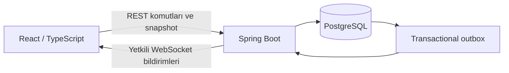

# Doping Keşif

**Birlikte soru çöz, birlikte keşfet.**

Doping Keşif, iki öğrencinin aynı soruları cevaplayarak ortak bir puzzle’ı tamamladığı gerçek zamanlı öğrenme uygulamasıdır. Her doğru cevap görselin bir parçasını açar. Öğrenciler 10 soruluk oyunun ardından katkılarını, kazandıkları XP’yi ve kişisel koleksiyonlarını görebilir.

Uygulama, Doping Hafıza dashboard düzenini esas alır. Sol menü, üst arama/profil ve sağ takvim alanı korunurken Keşif deneyimi orta alanda çalışır.

## Amaç

Soru çözmeyi arkadaşla ortak bir hedef etrafında birleştirmek ve öğrencinin ilerlemesini görünür kılmak. Koleksiyon ve keşif görevleri, bir sonraki çalışma için devam eden bir hedef sunar. Öğrenme ve katılım üzerindeki etkiler pilot uygulamada ölçülecektir.

## Özellikler

- **Keşif görevleri:** Tarihi Şehir, Doğa Keşfi, Şehir Manzarası ve Renkli Dünya.
- **Çalışma seçimi:** 5–8. sınıf, sınıfa uygun dersler ve isteğe bağlı konu filtresi.
- **İki katılım yöntemi:** Arkadaş daveti veya oda kodu/paylaşım bağlantısı.
- **Ortak lobi:** Oyuncu avatarları, hazır durumları ve oda sahibi tarafından başlatma.
- **Eş zamanlı oyun:** Aynı 10 soru, bağımsız cevaplar ve sunucu kontrollü süre.
- **20 parçalı puzzle:** Her turda doğru cevaplara göre 0, 1 veya 2 yeni parça.
- **Parça açılma animasyonu:** Sallanan kilit, ortadan açılan bulanık kapak ve ortaya çıkan görsel.
- **Oyun sonucu:** Tamamlanma vurgusu, iki oyuncunun katkısı ve sunucudan gelen XP.
- **Kalıcı ilerleme:** Kişisel koleksiyon, tamamlanan görev etiketleri ve oyun geçmişi.
- **Canlı bağlantı:** WebSocket bildirimleri, yeniden bağlanma ve REST ile durum eşitleme.

## Ekran görüntüleri

Ekran görüntüleri bu bölüme daha sonra eklenecektir. Görseller için [docs/images](docs/images/README.md) klasörü ayrılmıştır.

<!-- Görselleri ekledikten sonra aşağıdaki örnekleri etkinleştirin.


-->

## Oyun akışı

1. Bir keşif görevi seçilir.
2. Sınıf, ders ve isteğe bağlı konu belirlenir.
3. Arkadaş davet edilir veya oda koduyla eşleşilir.
4. İki oyuncu lobide hazır olur ve oda sahibi oyunu başlatır.
5. Öğrenciler 10 ortak soruya ayrı ayrı cevap verir.
6. Doğru cevaplar puzzle parçalarını açar. Oyun sonunda sonuç ve kişisel ilerleme kaydedilir.

## Teknoloji altyapısı

| Katman | Teknolojiler |
| --- | --- |
| Frontend | React 19, TypeScript, Vite, React Router |
| İstemci verisi | TanStack Query, Zod |
| Backend | Java 21, Spring Boot 3.5, Spring Security, Spring Data JPA |
| Veritabanı | PostgreSQL 16, Flyway |
| Canlı iletişim | WebSocket, transactional outbox, REST snapshot |
| Kimlik | JWT RS256, katılımcı ve grup bazlı yetki kontrolleri |
| API dokümantasyonu | OpenAPI / Swagger UI, local profilde |
| Kontroller | JUnit, Spring entegrasyon testleri, Testcontainers, Vitest, Testing Library |
| Geliştirme | Maven Wrapper, Docker Compose, GitHub Actions frontend kontrolleri |

## Mimari



**Frontend:** `app`, `layouts`, `features`, `shared` ve `styles` katmanlarından oluşur. Özellikler birbirini doğrudan içe aktarmaz. Uygulama katmanı sayfaları birleştirir. API cevapları şema doğrulamasından geçer. Oturum değişiminde istemci verisi temizlenir.

**Backend:** Kimlik, katalog, davet, oda, oyun ve ilerleme alanlarını yönetir. Soru seçimi, süre, cevap kabulü, parça açılması ve ödül hesaplama sunucuya aittir. Tekrarlanan isteklerde aynı işlem ikinci kez uygulanmaz.

**Veri:** PostgreSQL’in `kesif` şemasında 18 domain tablosu bulunur. Flyway migration dosyaları şemayı sürümler. Hibernate `ddl-auto=validate` ile şemayı doğrular. Oyun soruları snapshot olarak saklanır, koleksiyon kalıcıdır ve XP kayıtları eklemeli tutulur.

**Canlı iletişim:** Olaylar transaction içinde outbox’a yazılır. WebSocket değişiklikleri bildirir, istemci güncel durumu REST üzerinden okur. Bağlantı yeniden kurulduğunda durum eşitlenir. Mevcut tasarım tek backend instance hedefler.

## Proje yapısı

```text
doping-kesif/
├── backend/
│   ├── .mvn/                         # Maven Wrapper ayarları
│   ├── src/main/java/com/doping/kesif/
│   ├── src/main/resources/
│   │   ├── content/                  # Yerel soru bankası
│   │   └── db/migration/             # PostgreSQL migration dosyaları
│   ├── src/test/                     # Backend testleri
│   └── pom.xml
├── frontend/
│   ├── public/                       # Ürün görselleri
│   ├── src/
│   │   ├── app/
│   │   ├── layouts/
│   │   ├── features/
│   │   ├── shared/
│   │   └── styles/
│   └── package.json
├── docs/                             # API, veri modeli ve mimari belgeleri
├── scripts/start-local.ps1           # Docker PostgreSQL + local backend
├── .github/workflows/                # Frontend CI
├── .env.example
└── compose.yaml
```

## Yerel kurulum

### Gereksinimler

- JDK 21
- Node.js 24 LTS ve npm
- Git
- Çalışan Docker Desktop / Docker Engine, Linux container desteği

Maven kurulumu gerekmez. Wrapper ilk kullanımda Maven ve bağımlılıkları indirir. Portlar varsayılan olarak frontend için `5173`, backend için `8080`, PostgreSQL için `5432` değerindedir.

### 1. Repository’yi klonlama

```powershell
git clone https://github.com/YusufGocen/Doping-Kesif.git
cd Doping-Kesif
Copy-Item .env.example .env
```

`.env` dosyasındaki `POSTGRES_PASSWORD` değerini yerel bir parolayla değiştirin. Gerçek `.env` dosyalarını veya anahtarları Git’e eklemeyin.

### 2. Backend ve PostgreSQL

Proje kökünde, PowerShell terminalinde:

```powershell
powershell -NoProfile -ExecutionPolicy Bypass -File .\scripts\start-local.ps1
```

Script `.env` içindeki izin verilen değişkenleri yükler, Docker Compose ile PostgreSQL’i başlatır ve backend’i `local` profilde çalıştırır. İlk açılışta migration ve demo içerik yükleme işlemleri gerçekleşir. Terminal açık kalmalıdır.

Docker kullanmadan PostgreSQL bağlamak için `SPRING_DATASOURCE_URL`, `POSTGRES_USER` ve `POSTGRES_PASSWORD` değişkenlerini ayarlayıp backend’i `local` profilde çalıştırabilirsiniz. Projedeki `start-portable.ps1` yalnız özgün geliştirme ortamındaki harici araç dizinlerine yöneliktir, temiz klon için standart başlatıcı değildir.

### 3. Frontend

İkinci terminalde:

```powershell
cd frontend
npm.cmd ci
npm.cmd run dev
```

macOS/Linux terminalinde `npm.cmd` yerine `npm` kullanın. Geliştirme sunucusu REST ve WebSocket isteklerini yerel backend’e yönlendirir. İsteğe bağlı frontend ayarları [frontend/.env.example](frontend/.env.example) içinde açıklanır.

| Adres | İşlev |
| --- | --- |
| http://localhost:5173/giris | Demo kullanıcı girişi |
| http://localhost:8080/actuator/health | Backend sağlık kontrolü |
| http://localhost:8080/swagger-ui/index.html | Swagger UI, yalnız local profil |
| http://localhost:8080/v3/api-docs | OpenAPI, yalnız local profil |

### İki oyunculu yerel deneme

Aynı bilgisayarda iki ayrı tarayıcı veya ayrı tarayıcı profili açın. İki farklı demo hesapla giriş yapın. Birinde oda oluşturup diğerinde kodla katılın veya arkadaş davetini kabul edin. İki hesap hazır olduktan sonra oda sahibi oyunu başlatabilir.

Yerel JWT yalnız bellekte tutulur. Sayfa yenilendiğinde tekrar giriş gerekir. `localhost` bağlantısı başka bilgisayardan aynı uygulamaya erişim sağlamaz.

### Durdurma

Backend ve frontend terminallerinde `Ctrl+C` kullanın. PostgreSQL’i verisini koruyarak durdurmak için proje kökünde:

```powershell
docker compose stop postgres
```

## Sorular ve içerik

Başlangıç içerikleri [local-question-bank.json](backend/src/main/resources/content/local-question-bank.json) dosyasında bulunur ve local profilde PostgreSQL’e aktarılır. Mevcut envanter 332 soru ve 1328 seçenek içerir. Bu içerik 5–8. sınıflar için başlangıç kapsamıdır, tüm müfredatın eksiksiz soru havuzu değildir.

Gerçek Doping soru kaynağı entegrasyonu henüz yapılmamıştır. Ayrıntılar: [İçerik envanteri](docs/content-inventory.md).

## Testler

Frontend:

```powershell
cd frontend
npm.cmd run check
```

Bu komut biçim kontrolü, Vitest testleri, TypeScript ve üretim derlemesini çalıştırır.

Backend, çalışan Docker ile:

```powershell
cd backend
.\mvnw.cmd verify
```

Veritabanı entegrasyon testleri Testcontainers PostgreSQL kullanır. Docker yoksa ayrı bir test PostgreSQL’i yapılandırılabilir. Hiçbiri yoksa PostgreSQL testleri atlanabileceğinden test raporundaki atlanan test sayısı kontrol edilmelidir. Test veritabanı üretim veya geliştirme veritabanı olmamalıdır. Ayrıntılı komutlar: [Backend test raporu](docs/backend-e2e-status.md).

24 Ekim 2026 tarihli son tam ad geçişi doğrulamasında **113 backend ve 80 frontend testi** geçti. Bu sonuç gerçek iki tarayıcı görsel kabulünün tamamlandığı anlamına gelmez. Kanıt özeti: [Ad geçişi doğrulaması](docs/name-transition.md). Ağ testleri gerçek geçmiş ve XP oluşturabileceğinden demo verisinde bilinçli çalıştırılmalıdır.

## Teknik dokümantasyon

- [Frontend mimarisi](docs/frontend-architecture.md)
- [Veritabanı şeması](docs/database-schema.md) ve [ER diyagramı](docs/er-diagram.md)
- [Kimlik ve katalog API](docs/auth-and-catalog-api.md)
- [Davet ve lobi API](docs/lobby-api.md)
- [Oyun API](docs/game-api.md)
- [İlerleme ve ödüller API](docs/progress-and-rewards-api.md)
- [Gerçek zamanlı iletişim protokolü](docs/realtime-protocol.md)
- [Tarayıcı kabul kontrol listesi](docs/frontend-browser-e2e-status.md)
- [Geliştirme ilerleme kaydı](ilerleme.md)

Tarih içeren durum raporları ilgili aşamanın kaydıdır. Güncel ürün kapsamı bu README’de özetlenir.

## Mevcut kapsam ve sonraki aşama

Çalışan yerel MVP iki oyunculu uçtan uca oyun akışını içerir. Gerçek Doping kimlik sağlayıcısı, Butik grupları ve soru servisleri henüz bağlı değildir. Demo giriş production derlemesinde kapalıdır.

Üretime geçiş için bu entegrasyonlara ek olarak dağıtım, izleme, yük testleri, içerik kontrolü ve ayrı tarayıcı görsel kabulü tamamlanmalıdır. XP değerleri ve süreler demo ayarlarıdır, onaylanmış kurum politikası değildir. Kaynak kodunu GitHub’a yüklemek uygulamayı internete açmaz.

## Kullanım ve haklar

Bu repository’ye açık kaynak lisansı eklenmemiştir. Doping Hafıza marka ve görselleri ilgili hak sahiplerine aittir. Kodun veya varlıkların yeniden kullanımı için gerekli izinler ayrıca değerlendirilmelidir.