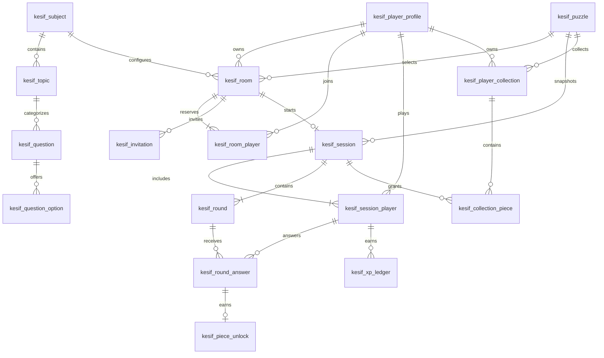

# Uygulanan ER modeli

18 domain tablosu. Tam kolon sözlüğü: [database-schema.md](database-schema.md). Referans ZIP'teki eski diyagram güncel şema değildir.

Outbox aggregate_type/aggregate_id alanları farklı aggregate türlerine referans verdiği için polymorphic referanstır; tek bir fiziksel FK yoktur. Olayı yazan servis transaction içinde doğru aggregate'ı doğrulamalıdır.

Room/Session başına **en fazla iki** oyuncu DB slot ve UNIQUE kısıtlarıyla korunur. **Tam iki hazır oyuncu**, **tam 10 soru**, doğru cevabın parça üretmesi ve geçerli durum geçişleri oyun servisinin transaction invariant'larıdır; bunlar henüz uygulanmadı. Tur numarasının 1–10 olması tek başına 10 satır bulunduğunu garanti etmez.

Oda sahibinin odada üye olması commit'e ertelenen FK ile korunur. Oda ile owner üyelik satırı tek transaction'da oluşturulmalıdır. Davet doğrudan odaya bağlıdır; maç için zorunlu davet veya karşılıklı session/invitation FK yoktur. Davet ve kodla gelen öğrenciler aynı oda/maç akışına bağlanır.

Entity'ler ilişkileri UUID referansları olarak tutar; ORM cascade ve otomatik entity graph yüklemesi yoktur. İlişkisel tutarlılık PostgreSQL FK'leriyle, erişim ve iş kuralları servislerle sağlanır. Entity'ler API yanıtı olarak serialize edilmeyecektir.
